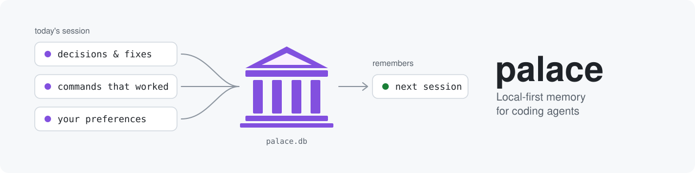
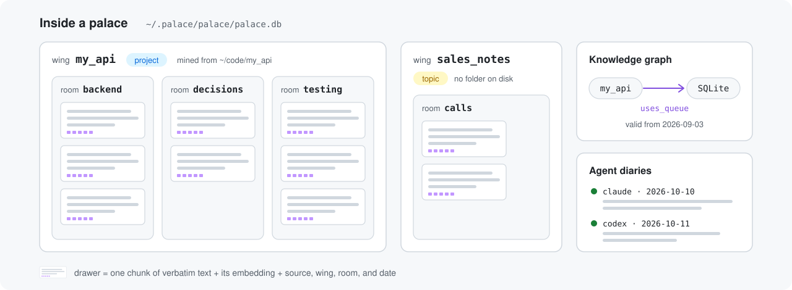
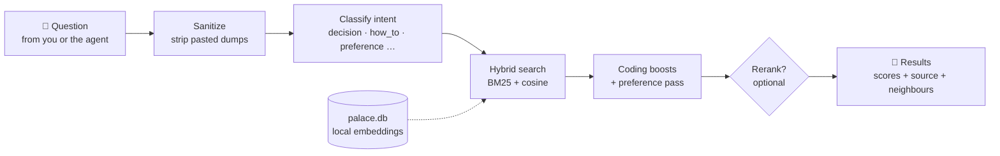
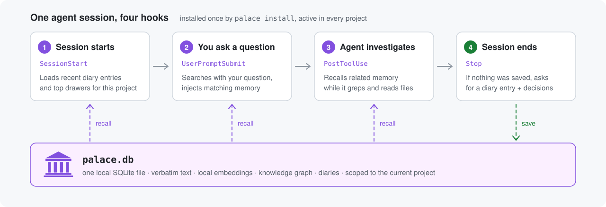
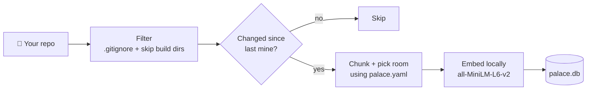

<p align="center">
  
</p>

<p align="center">
  <a href="https://github.com/AncientiCe/palace-rs/actions/workflows/ci.yml"></a>
  <a href="https://github.com/AncientiCe/palace-rs/releases/latest"></a>
  <a href="LICENSE"></a>
  
  
  <a href="https://registry.modelcontextprotocol.io"></a>
  
</p>

<p align="center">
  <b>Local-first memory for coding agents.</b><br>
  Your agent remembers decisions, fixes, commands, and preferences between sessions.<br>
  One binary, one SQLite file, no API keys, no cloud.
</p>

<p align="center">
  <a href="#-quick-start">Quick start</a> ·
  <a href="#-install">Install</a> ·
  <a href="#-how-it-works">How it works</a> ·
  <a href="#-supported-clients">Clients</a> ·
  <a href="#-cli-reference">CLI</a> ·
  <a href="#-mcp-tools">MCP tools</a> ·
  <a href="#-faq">FAQ</a>
</p>

---

Palace gives Claude Code, Codex, Cursor, Gemini CLI, VS Code, OpenCode,
Cline, Zed, Goose, Windsurf, and Claude Desktop a memory that
lasts between sessions. It stores what happened verbatim, recalls it
automatically when it's relevant, and cites where each answer came from.

```text
You:    why did we switch the queue to SQLite last month?
Agent:  [palace_search → wing my_api, room decisions, filed 2026-09-03]
        You dropped Redis because the deploy target had no persistent volume.
        The benchmark you ran is in the same drawer.
```

---

## 🧭 Why Palace

Every new agent session starts with no memory. You explain the architecture
again. The agent repeats a fix you rejected last week. It greps the whole repo
to rediscover a convention you settled months ago.

Palace fixes that by:

- **Storing text verbatim.** Code, notes, and conversations are stored as
  written, not as an LLM summary that loses detail.
- **Running locally.** Embeddings come from `all-MiniLM-L6-v2` on ONNX
  Runtime, on your CPU. Nothing leaves your machine unless you turn on
  [remote mode](#remote-mode-shared-team-memory).
- **Recalling without being asked.** Hooks inject relevant memory when a
  session starts, when you send a prompt, and while the agent investigates.
  The agent does not need to remember to search.
- **Citing sources.** Every result carries its wing, room, source file, drawer
  id, and score breakdown, so you can check where an answer came from.
- **Shipping as one binary.** No Python, no vector database, no Docker. One
  `palace` executable and one `palace.db` file.

It also works outside software projects. The `creative` and `personal`
[profiles](#profiles) adapt it for worldbuilding, fiction, coaching, or
household notes.

---

## 📦 Install

Pick one. Each method installs the `palace` binary. Run `palace install`
afterwards to connect your agents.

**macOS / Linux**

```bash
curl -fsSL https://raw.githubusercontent.com/AncientiCe/palace-rs/main/scripts/install.sh | sh
```

**Windows (PowerShell)**

```powershell
irm https://raw.githubusercontent.com/AncientiCe/palace-rs/main/scripts/install.ps1 | iex
```

The scripts download the matching GitHub Release binary, verify its SHA-256
checksum, and install it. To upgrade later, run the same command again.

**Homebrew (macOS Apple Silicon / Linux)**

```bash
brew tap AncientiCe/palace
brew install palace
```

To upgrade, refresh the tap first. Without `brew update`, Homebrew can keep
reporting the old version as already installed:

```bash
brew update && brew upgrade palace
```

When a release changes the memory protocol rule (the CHANGELOG says so), run
`palace install` again afterwards so your agents get the new rule text.

**MCP registry / MCPB bundle.** Palace is listed in the official
[MCP registry](https://registry.modelcontextprotocol.io) as
`io.github.ancientice/palace-rs`. Each release also ships a `palace-<version>.mcpb`
bundle (Linux x86_64, macOS arm64, Windows x86_64) for one-click install in
MCPB-aware hosts such as Claude Desktop.

**From source**

```bash
git clone https://github.com/AncientiCe/palace-rs && cd palace-rs
cargo build --release   # binary at target/release/palace
```

| Platform | Status |
|---|---|
| Linux x86_64 | Supported |
| macOS Apple Silicon | Supported |
| Windows x86_64 | Supported |
| macOS Intel | Not supported (no ONNX Runtime build) |

The embedding model (~90 MB) downloads from Hugging Face the first time you
mine or search, then stays cached in `~/.cache/huggingface`.

---

## ⚡ Quick start

```bash
palace install            # connect every supported agent on this machine
palace doctor             # check that every client is wired up
palace init ~/my-project --yes --auto-mine   # detect rooms, write palace.yaml, mine
```

Restart your agent app so it reloads its MCP config. Then try:

> "What do we know about how this project handles database migrations?"

The agent should call `palace_search` and answer from memory, citing the
drawer it used. You can also search from the terminal:

```bash
palace search "how did we decide on the database schema"
```

From then on, the agent writes a diary entry after substantial work and stores
durable decisions as facts. Tomorrow's session, from any of your agents, picks
up where today's left off.

---

## 🔍 How it works

### The palace

Memory is organised like a building, which keeps search focused:

<p align="center">
  
</p>

<sub><i>Figure 1. One palace holds many wings. Rooms group drawers, and the knowledge graph and diaries sit alongside them.</i></sub>

| Concept | What it is | Example |
|---|---|---|
| **Wing** | A project or a topic | `my_api`, `sales_notes` |
| **Room** | An area inside a wing | `backend`, `testing`, `decisions` |
| **Drawer** | One chunk of verbatim text plus its embedding and metadata | a paragraph of `db.rs`, a diary entry |
| **Knowledge graph** | Time-stamped facts: subject → predicate → object | `my_api → uses_queue → SQLite` (valid from 2026-09-03) |
| **Diary** | Per-agent session notes for continuity | "Fixed the flaky migration test by…" |
| **Tunnel** | A link between rooms in different wings | `my_api/auth` ↔ `my_web/login` |

Wings are either **project** wings (a folder on disk, created by `palace mine`)
or **topic** wings (no folder, such as chat history or meeting notes, created
with `palace_create_wing`).

### Retrieval



<sub><i>Figure 2. What happens to a query. Everything runs locally on your CPU.</i></sub>

Search fuses BM25 keyword scoring with cosine similarity over local
embeddings. It then applies intent boosts for coding questions. Each query is
classified as `preference`, `decision`, `how_to`, `definition`, `temporal`, or
`unknown`. Preference-shaped questions ("how do I like my commits?") get a
dedicated pass against tagged preference spans. A local cross-encoder
reranker is available as an option (`--rerank` or `PALACE_RERANK=1`).

Agent-generated query dumps are cleaned up before retrieval. Results come back
with score provenance (`combined`, `cosine`, `bm25`, `coding_boost`,
`preference_match`, `rerank_score`, `intent`) and the neighbouring chunks from
the same source file.

### Automatic recall (hooks)

`palace install` registers user-level hooks, so memory works in every project
without editing per-project files:

<p align="center">
  
</p>

<sub><i>Figure 3. Three hooks read memory into the session. The fourth makes sure the session's lessons get written back.</i></sub>

| Hook | What it does |
|---|---|
| **Session start** | Injects the memory protocol, your standing rules from `general/preferences` (verbatim, in every project), recent diary entries for this project (from any agent), and the top drawers of the project's wing. |
| **Prompt submit** | Searches Palace with your actual question and injects matching drawers before the agent answers. If a history question finds nothing, it tells the agent to run `palace_search`. In Claude Code it also adds a one-line reminder until the session calls a Palace tool. Skips short prompts and slash commands. Claude Code and Codex only. |
| **Post tool use** | While the agent greps and reads files, recalls related memory so earlier decisions surface without a search. In Claude Code it also records the session's Palace calls. |
| **Stop** | If the session did real work but saved nothing, asks the agent once to write a diary entry and record decisions before it finishes. In Claude Code this is judged per session, including sessions that never used Palace; other agents use a recent-activity window. |

Auto-recall is limited to the current project. Drawers from your other
project wings and diaries from other projects stay out. Topic wings still
appear.

All hooks fail open: if the palace is missing or empty, the agent works as
normal.

### The memory protocol

`palace install` also writes a short rule into each client's instruction file.
The rule tells the agent when to use memory:

1. **Session start:** `palace_status` → `palace_session_context` → `palace_diary_search`.
2. **Before answering** a question about past decisions, preferences, or
   history: `palace_search` and `palace_kg_query`, before grep.
3. **After work:** `palace_diary_write`, plus `palace_kg_add` for durable facts.

Grep remains the right first tool for current symbols, exact definitions, and
code that may have changed since it was mined.

The nine protocol tools are marked `_meta."anthropic/alwaysLoad" = true`, so
Claude Code 2.1.121 and later keeps them loaded instead of deferring them
behind tool search.

### Memory layers

| Layer | Name | Contents |
|---|---|---|
| L0 | Identity | `~/.palace/identity.txt`, always loaded (~100 tokens) |
| L1 | Essential story | Top drawers by importance, grouped by room (~600–900 tokens) |
| L2 | On demand | Wing- and room-filtered retrieval |
| L3 | Deep search | Full hybrid search across the palace |

`palace wake-up` prints L0 and L1. Agents reach L2 and L3 through MCP tools.

---

## 🔌 Supported clients

`palace install` configures every supported client by default
(`--client all`). Gemini CLI, VS Code, Windsurf, OpenCode, Cline, Zed and
Goose are included only when their config folder exists, so Palace never sets up an agent you don't
have. Use `--client <name>` to configure one explicitly.

| Client | `--client` | MCP config | Rule file | Hooks |
|---|---|---|---|---|
| Claude Code | `claude` | `~/.claude.json` | `~/.claude/CLAUDE.md` | `~/.claude/settings.json` |
| Codex | `codex` | `~/.codex/config.toml` | `~/.codex/AGENTS.md` | `~/.codex/hooks.json` (run `/hooks` once in the Codex CLI to trust them) |
| Cursor | `cursor` | `~/.cursor/mcp.json` | `~/.cursor/rules/palace.mdc` | `~/.cursor/hooks.json` |
| Gemini CLI | `gemini` | `~/.gemini/settings.json` | `~/.gemini/GEMINI.md` | `~/.gemini/settings.json` (run only in folders you trust in Gemini) |
| VS Code (Copilot) | `vscode` | `Code/User/mcp.json` | `Code/User/prompts/palace.instructions.md` | `~/.copilot/hooks/palace.json` (no prompt-time recall: VS Code can't inject there) |
| OpenCode | `opencode` | `~/.config/opencode/opencode.json` | `~/.config/opencode/palace.md`, listed under `instructions` | `~/.config/opencode/plugins/palace.js` |
| Cline | `cline` | `~/.cline/data/settings/cline_mcp_settings.json` | `~/.cline/rules/palace.md` | `Documents/Cline/Hooks` (prompt and post-tool recall; Cline can't continue after a task, so no save nudge). Your own hook scripts are never overwritten. |
| Zed | `zed` | Zed `settings.json` (`context_servers`) | Zed's global `AGENTS.md` | None. Zed's agent has no hooks; external agents in Zed use their own Palace setup. |
| Goose | `goose` | Goose `config.yaml` (`extensions`) | Goose `.goosehints` | `~/.agents/plugins/palace` (save nudge only; Goose hooks can't inject context; needs `sh` on Windows) |
| Windsurf | `windsurf` | `~/.codeium/windsurf/mcp_config.json` | `~/.codeium/windsurf/memories/global_rules.md` | None. Cascade hooks can't inject context. Devin Local reuses the Claude Code hooks. |
| Claude Desktop | `claude-desktop` | `claude_desktop_config.json` | `~/.claude/CLAUDE.md` | None. Use the [MCP prompts](#mcp-prompts) instead. |

Rule files are written as a managed block. Your existing content is kept.

```bash
palace install --client claude                       # one client only
palace install --scope project --path ./my-project   # project-level rule files
palace install --no-rule                             # MCP wiring only, no rule
palace install --dry-run                             # preview the changes
palace uninstall                                     # undo everything
```

With `--scope project`, rules go to `<project>/CLAUDE.md`, `<project>/AGENTS.md`
(Codex, OpenCode, Cline, Zed and Goose), `<project>/GEMINI.md`, `<project>/.github/copilot-instructions.md`,
`<project>/.windsurf/rules/palace.md`, and `<project>/.cursor/rules/palace.mdc`.
Cursor, VS Code and OpenCode also get a project MCP config
(`.cursor/mcp.json`, `.vscode/mcp.json`, `opencode.json`).

<details>
<summary>Manual MCP config</summary>

Any MCP client can run Palace as a stdio server with `palace mcp`.

JSON clients (Claude Code, Cursor, Claude Desktop):

```json
{
  "mcpServers": {
    "palace": { "command": "palace", "args": ["mcp"] }
  }
}
```

Codex (`~/.codex/config.toml`):

```toml
[mcp_servers.palace]
command = "palace"
args = ["mcp"]
```

Claude Code CLI:

```bash
claude mcp add palace -- palace mcp
```

</details>

### MCP prompts

Claude Desktop cannot run hooks, so the server offers two prompts in its
prompt picker:

| Prompt | What it does |
|---|---|
| `continue-session` | Loads warm-start context so the agent picks up where you left off |
| `save-session` | Saves the session to memory so it carries over next time |

### Profiles

A profile changes the agent rule, the protocol text, and which rooms
`palace init` looks for:

| Profile | For | Typical rooms |
|---|---|---|
| `coding` (default) | Software projects | frontend, backend, testing, docs, config |
| `creative` | Worldbuilding, D&D, fiction | characters, places, lore, factions, timeline |
| `personal` | Coaching, caregiving, household, client notes | people, health, finances, home, schedule |

```bash
palace install --profile creative
```

The profile is saved to `~/.palace/config.json`. Set `PALACE_PROFILE` to
override it for one process.

### Remote mode (shared team memory)

By default, `palace mcp` serves your local palace. Remote mode turns it into a
stdio-to-HTTP bridge to a shared [Palace Server](https://palacememory.com),
the commercial, self-hosted team edition. Client registrations do not change.

```bash
palace remote set --endpoint https://palace.yourco.com   # prompts for the ps_… API key
palace remote on
palace remote test      # runs the MCP handshake and reports the tool count
palace remote status    # mode, endpoint, masked key
palace local            # back to the local palace
```

---

## 🧰 CLI reference

Run `palace <command> --help` for every flag.

**Setup**

| Command | What it does |
|---|---|
| `palace install` | Register the MCP server, rules, and hooks with your agents |
| `palace uninstall` | Remove them again |
| `palace doctor` | Check the binary, database, MCP configs, and rules |
| `palace seed-adoption-facts` | Seed knowledge-graph facts that make agent recall measurable |

**Adding memory**

| Command | What it does |
|---|---|
| `palace init <dir>` | Detect rooms and write `palace.yaml` (`--yes` skips prompts, `--auto-mine` mines straight after) |
| `palace mine <dir>` | Chunk, embed, and store project files. Re-runs only process changed files. |
| `palace watch <dir>` | Re-mine changed files automatically as you work |
| `palace mine-convos <dir>` | Ingest chat exports: Claude Code and Codex JSONL, Claude.ai, ChatGPT, Slack |
| `palace sweep <path>` | Store transcript JSONL files as one drawer per message |
| `palace split` | Split concatenated Claude Code transcripts into one file per session |

**Finding memory**

| Command | What it does |
|---|---|
| `palace search <query>` | Hybrid search (`--wing`, `--room`, `--limit`, `--rerank`) |
| `palace wake-up` | Print the L0 identity and L1 essential story |
| `palace status` | Drawer counts by wing and room |
| `palace wings` | Registered wings, with kind, drawer count, and last mined time |
| `palace timeline` | Knowledge-graph facts in time order (`--entity` to filter) |
| `palace gain` | How much your agents use Palace, and what it saves |

**Maintenance**

| Command | What it does |
|---|---|
| `palace export` / `palace import <file>` | Back up or restore drawers as JSON (embeddings are rebuilt on import) |
| `palace prune --older-than-days <n>` | Delete old drawers (`--dry-run` to preview) |
| `palace repair` | Re-embed drawers that are missing vectors |
| `palace upgrade-embeddings` | Re-embed everything (`--refresh-preferences` for preference spans) |
| `palace migrate <db>` | Copy drawers from another palace database |
| `palace compress` | Compress drawers to the AAAK dialect |

**Servers**

| Command | What it does |
|---|---|
| `palace mcp` | Start the MCP stdio server |
| `palace remote …` / `palace local` | Configure and toggle [remote mode](#remote-mode-shared-team-memory) |
| `palace hook <event> --client <c>` | Hook runner called by the installed hooks |

### Mining a project



<sub><i>Figure 4. Mining only touches files that changed, so re-running it is cheap.</i></sub>

`palace mine` respects `.gitignore` and skips `.git`, `node_modules`,
`target`, `build`, `dist`, `vendor`, and other build output. It reads common
text and source formats: `md`, `txt`, `rs`, `py`, `js`, `ts`, `tsx`, `go`,
`java`, `rb`, `sh`, `sql`, `json`, `yaml`, `toml`, `html`, `css`, `csv`, and
more.

```bash
palace mine ~/my-project \
  --wing my_project            # override the wing name
  --limit 100                  # process at most 100 new or changed files
  --dry-run                    # preview without storing
  --no-gitignore               # ignore .gitignore rules
  --include vendor,third_party # force-include these paths
```

`--limit` runs can be resumed: the next run continues from where the last
one stopped.

### Measuring value with `palace gain`

```bash
palace gain                       # last 30 days
palace gain --project my_project --since 7d
palace gain --history             # recent tool calls
palace gain --json
palace gain --record <query_id> <drawer_id> useful   # or not_useful / wrong_answer
```

```text
palace gain - last 30d (my_project)
  Tool calls         : 412   (sessions: 27)
  Hit rate           : 88%   (search hits 142/162)
  Precision@1        : 92%
  Precision@5        : 95%
  Tokens saved (est) : ~78,400
  Re-index skipped   : 31    (duplicate drawers avoided)
  KG facts recalled  : 56
  Diary recalls      : 8
  Repeat Qs avoided  : 19
  p95 latency        : 41 ms
```

Usage metadata stays in your local `palace.db`. Set `PALACE_GAIN_DISABLED=1`
to turn recording off.

---

## 🧩 MCP tools

<details>
<summary>All 49 tools</summary>

**Status and health**

| Tool | Description |
|---|---|
| `palace_status` | Palace overview: drawer and wing counts, recent sessions (`verbose` adds rooms, protocol text, AAAK spec) |
| `palace_verify` | Check MCP tools, database health, embeddings, and model cache |
| `palace_recall_check` | Run project-memory probes and report expected hits |
| `palace_gain` | Usage gains and savings. Accepts an optional `record` payload for feedback. |
| `palace_memory_report` | Readable inventory: profile, per-wing and per-room counts, recent activity |

**Wings and taxonomy**

| Tool | Description |
|---|---|
| `palace_project_status` | Is this project mined, registered but unmined, or unknown? |
| `palace_mine` | Mine a code repository on demand (after the user agrees) |
| `palace_create_wing` | Declare a topic or project wing |
| `palace_list_wings` | Registered wings with kind, path, last mined time, and counts |
| `palace_list_rooms` | Rooms within a wing |
| `palace_get_taxonomy` | Full wing → room → count tree |

**Search**

| Tool | Description |
|---|---|
| `palace_search` | Hybrid search with score provenance and source context |
| `palace_preference_search` | Dedicated pass for preference and convention questions |
| `palace_check_duplicate` | Check whether content already exists |

**Drawers**

| Tool | Description |
|---|---|
| `palace_add_drawer` | Store content in a wing and room |
| `palace_remember` | Store a key fact with importance 5 |
| `palace_get_drawer` | Fetch a drawer by id |
| `palace_list_drawers` | List drawers, with optional wing and room filters |
| `palace_update_drawer` | Update content and refresh metadata |
| `palace_delete_drawer` / `palace_forget` | Remove a drawer |
| `palace_explain` | Full provenance: who stored it, when, from where, importance |
| `palace_prune` | Remove stale or low-value drawers |
| `palace_export` / `palace_import` | Export or import palace data |
| `palace_upgrade_embeddings` | Re-embed drawers and refresh preference vectors |

**Knowledge graph**

| Tool | Description |
|---|---|
| `palace_kg_query` | Query an entity's relationships |
| `palace_kg_add` | Add a fact (subject → predicate → object) |
| `palace_kg_invalidate` | Mark a fact as no longer true |
| `palace_kg_timeline` | Facts in time order |
| `palace_kg_stats` | Graph overview |
| `palace_conflicts` | Find stale or contradictory facts |
| `palace_seed_adoption_facts` | Seed adoption and quality-gate facts |

**Graph and tunnels**

| Tool | Description |
|---|---|
| `palace_traverse` | Breadth-first walk from a room |
| `palace_find_tunnels` | Rooms that bridge two wings |
| `palace_create_tunnel` / `palace_list_tunnels` / `palace_delete_tunnel` | Manage stored tunnels |
| `palace_follow_tunnels` | Follow tunnels from a wing and room |
| `palace_graph_stats` | Graph summary |

**Diaries and sessions**

| Tool | Description |
|---|---|
| `palace_diary_write` | Write a diary entry |
| `palace_diary_read` | Read recent entries |
| `palace_diary_search` | Search diaries. `all_agents: true` searches every agent's diary. |
| `palace_session_context` | Warm-start context. Falls back to other agents' recent work on the project. |
| `palace_list_agents` | List agent diaries |

**Internal**

| Tool | Description |
|---|---|
| `palace_get_aaak_spec` | The AAAK compressed-memory dialect spec |
| `palace_hook_settings` | Hook settings |
| `palace_memories_filed_away` | Acknowledgement used by the stop hook |

</details>

---

## 🔧 Configuration

Settings load in this order: environment variables, then
`~/.palace/config.json`, then defaults.

| Env var | Default | Description |
|---|---|---|
| `PALACE_PALACE_PATH` | `~/.palace/palace` | Data directory. The database is `palace.db` inside it. |
| `PALACE_PROFILE` | `coding` | `coding`, `creative`, or `personal` |
| `PALACE_RERANK` | off | `1` turns on the local reranker for every search |
| `PALACE_RERANK_MODEL` | built-in | Override the reranker model |
| `PALACE_ENTITY_LANGUAGES` | `en` | Comma-separated languages for entity detection |
| `PALACE_GAIN_DISABLED` | off | `1` turns off usage recording |
| `PALACE_PROJECT` | auto | Project name used for gain attribution |
| `PALACE_SOURCE_DIR` | `~/Desktop/transcripts` | Default source for `palace split` |
| `PALACE_MINE_TRACE` | off | `1` prints per-stage mining timings |
| `PALACE_MCP_MODE` | `local` | `local` or `remote` |
| `PALACE_REMOTE_ENDPOINT` | none | Palace Server URL (host, base URL, or full `/mcp` URL) |
| `PALACE_API_KEY` | none | Palace Server API key (`ps_…`) |

`config.json` takes the same settings as keys: `palace_path`, `profile`,
`entity_languages`, `topic_wings`, `people_map`, `mcp_mode`,
`remote_endpoint`, `remote_api_key`. Palace writes this file with owner-only
`0600` permissions.

### `palace.yaml` (per project)

`palace init` creates this file. Edit it to tune how files map to rooms:

```yaml
wing: my_project
rooms:
  - name: backend
    description: Server and API code
    keywords: [api, server, routes, models]
  - name: frontend
    description: UI components
    keywords: [ui, components, pages, views]
  - name: general
    description: Everything else
    keywords: []
```

---

## 📊 Benchmarks

### Coding-agent memory eval

A fixture of realistic project memories (decisions, past failures, commands,
conventions, preferences, current direction) with 40 questions such as:

- why did we choose bundled sqlite?
- how did we fix the migration test failure last time?
- what clippy command should I run?

```bash
cargo test --test coding_agent_eval -- --nocapture
```

The test reports `recall@1` and `recall@5`, and fails if retrieval drops below
a fixed threshold. It answers the question that matters: can a coding agent
find the right project context when it needs it?

### LongMemEval

Retrieval recall on LongMemEval `s_cleaned`: 470 evaluated questions, each
over a haystack of about 50 sessions and 115k tokens. The 30 abstention
questions are excluded, as is standard.

| Split | R@1 | R@5 | R@10 |
|---|---:|---:|---:|
| `longmemeval_oracle` (sanity check) | 1.000 | 1.000 | 1.000 |
| `longmemeval_s_cleaned` | **0.889** | **0.981** | **0.991** |

<details>
<summary>Method and per-type results</summary>

- **Granularity:** one drawer per session, with user and assistant turns
  embedded together. No filtering, summarisation, or LLM extraction.
- **Embedder:** `all-MiniLM-L6-v2` (384-dim, ONNX), 512-token cap, local.
- **Retrieval:** BM25 (k1=1.5, b=0.75, weight 0.35) fused with cosine (weight
  0.65), top-K 10. This run predates the coding-agent intent boosts.
- **No LLM at any stage**, no per-dataset tuning, no GPU.
- **Metric:** `recall_any@K` at session granularity.
- **Hardware:** Apple M1 Pro, 32 GB RAM.

| Question type | R@1 | R@5 | R@10 |
|---|---:|---:|---:|
| knowledge-update | 0.944 | 1.000 | 1.000 |
| multi-session | 0.909 | 0.983 | 1.000 |
| single-session-assistant | 1.000 | 1.000 | 1.000 |
| single-session-preference | 0.633 | 0.867 | 0.933 |
| single-session-user | 0.922 | 1.000 | 1.000 |
| temporal-reasoning | 0.835 | 0.976 | 0.984 |

The `oracle` split only contains the gold sessions, so it checks the pipeline
rather than measuring retrieval. Most top-1 misses on `s_cleaned` are
near-misses at rank 2–5. Preference questions are the weakest category,
because "I prefer…" sentences rarely share keywords with the question. The
dedicated preference pass added since this run targets that gap.

</details>

---

## 🔒 Privacy and data

- **Everything is local by default.** One SQLite file at
  `~/.palace/palace/palace.db`. Embeddings are computed on your CPU.
- **Network access** is limited to the one-time model download from Hugging
  Face, and to your own Palace Server if you turn on remote mode.
- **No telemetry.** `palace gain` statistics are written to your local
  database only.
- **Back up** with `palace export`, or copy `palace.db`.
- **Delete** a single memory with `palace_forget`, or everything by removing
  `~/.palace`.

Palace stores whatever you mine. Exclude secrets with `.gitignore` before you
mine a repository.

---

## 🩺 Troubleshooting

| Problem | Fix |
|---|---|
| The agent never calls Palace | Run `palace doctor`, then fully restart the agent app. In the Codex CLI, run `/hooks` once to trust the hooks. |
| `palace: command not found` | Open a new terminal so `PATH` picks up the install directory, or run `palace doctor` with the full path. |
| No search results | Check `palace status`. If the project has no drawers, run `palace init <dir> --yes --auto-mine`. |
| Results are out of date | Run `palace mine <dir>` again (only changed files are processed), or keep `palace watch <dir>` running. |
| Model download fails | Check that `huggingface.co` is reachable, then retry. The model is cached after the first successful download. |
| Searches feel slow on first run | The first call loads the ONNX model. Later calls in the same session are fast. |
| Some drawers have no vectors | `palace repair` |

---

## ❓ FAQ

<details>
<summary><b>Do I have to tell my agent to use it?</b></summary>

No. After `palace install`, hooks inject relevant memory at session start, when
you send a prompt, and while the agent reads code. The installed rule tells the
agent to search memory before answering history questions and to save what it
learned afterwards.

</details>

<details>
<summary><b>How is this different from CLAUDE.md or AGENTS.md?</b></summary>

Those files are instructions you write and maintain by hand, and every line is
loaded into every session. Palace is searchable memory that grows as you work:
only the parts relevant to the current question are recalled, and the same
memory is shared by Claude Code, Codex, Cursor, and Claude Desktop. Keep using
instruction files for rules; use Palace for history.

</details>

<details>
<summary><b>Does it send my data anywhere?</b></summary>

No. Storage, embeddings, and search all run locally. The only network calls
are the one-time model download from Hugging Face and, if you turn it on,
your own Palace Server in remote mode. See [Privacy and data](#-privacy-and-data).

</details>

<details>
<summary><b>Will it slow my agent down?</b></summary>

Searches typically take tens of milliseconds (`palace gain` shows your real
p50 and p95). The first call in a session loads the embedding model. Hooks fail
open, so a missing or broken palace never blocks the agent.

</details>

<details>
<summary><b>What happens when a memory goes out of date?</b></summary>

Re-running `palace mine` updates changed files. For facts, agents call
`palace_kg_invalidate` and add the new fact, so the timeline keeps both.
`palace_conflicts` flags facts that look stale or contradictory, and
`palace_forget` or `palace prune` removes drawers you no longer want.

</details>

<details>
<summary><b>Can my whole team share one memory?</b></summary>

Different agents on one machine already share it: a Codex session can pick up
a Claude Code session's diary. For a team, [remote mode](#remote-mode-shared-team-memory)
points every `palace mcp` at a shared, self-hosted Palace Server.

</details>

<details>
<summary><b>Is it only for code?</b></summary>

No. The `creative` and `personal` [profiles](#profiles) tune Palace for
worldbuilding, fiction, coaching, caregiving, and household notes. Palace
reads Markdown and text files, so Claude Desktop users can install the MCPB
bundle and start without writing code.

</details>

---

## 📚 Using Palace as a library

Palace is also a Rust crate (`palace`). Add it as a git dependency:

```toml
[dependencies]
palace-rs = { git = "https://github.com/AncientiCe/palace-rs", default-features = false }
```

```rust
use palace::{db, knowledge_graph, store};

let conn = db::open_in_memory()?;
store::add_drawer(&conn, "wing_code", "backend",
    "We use SQLite with WAL mode for concurrent reads.",
    None, "architecture.md", 0, "example", 4.0)?;
knowledge_graph::add_triple(&conn, "Palace", "stores_data_in", "SQLite",
    Some("2026-04-01"), None, 1.0, None, None)?;
```

`default-features = false` leaves out the CLI dependencies. For the full
example, see [`examples/basic_usage.rs`](examples/basic_usage.rs)
(`cargo run --example basic_usage`). `palace::palace::Palace::search_with_provenance` returns
the same score details as the MCP tools.

---

## 🧪 Development

```bash
cargo fmt
cargo clippy --all-targets --all-features -- -D warnings
cargo test --all-features
cargo audit
```

Tests use in-memory SQLite, and only tests that need the embedding model load
it. See [CONTRIBUTING.md](CONTRIBUTING.md), [SECURITY.md](SECURITY.md), and
[CHANGELOG.md](CHANGELOG.md).

---

## 🚚 Migrating from older versions

<details>
<summary>From <code>mempalace</code> (0.1.x)</summary>

Version 0.2.0 renamed the project from `mempalace` to `palace`. The 0.2.x line
kept the old names working with warnings. They were removed in 0.3.0.

To upgrade from 0.1.x, either install a 0.2.x release first and run
`palace install`, which migrates configs and moves `~/.mempalace` to
`~/.palace`, or rename by hand: `~/.mempalace` → `~/.palace`,
`mempalace.yaml` → `palace.yaml`, `MEMPALACE_*` → `PALACE_*`, and the
`mempalace_*` MCP tools → `palace_*`. Hooks that ran `mempalace mcp` or
`python -m mempalace.mcp_server` should now run `palace mcp`.

</details>

<details>
<summary>From the Python version</summary>

The Rust version replaces ChromaDB plus SQLite with a single `palace.db`.
ChromaDB data cannot be converted, so re-ingest:

```bash
palace init ~/my-project --yes --auto-mine
palace mine-convos ~/Desktop/transcripts
palace status
```

`identity.txt`, `people_map.json`, and `known_names.json` in `~/.palace/` are
still compatible and are read automatically.

</details>

---

## 📜 License

[MIT](LICENSE)
